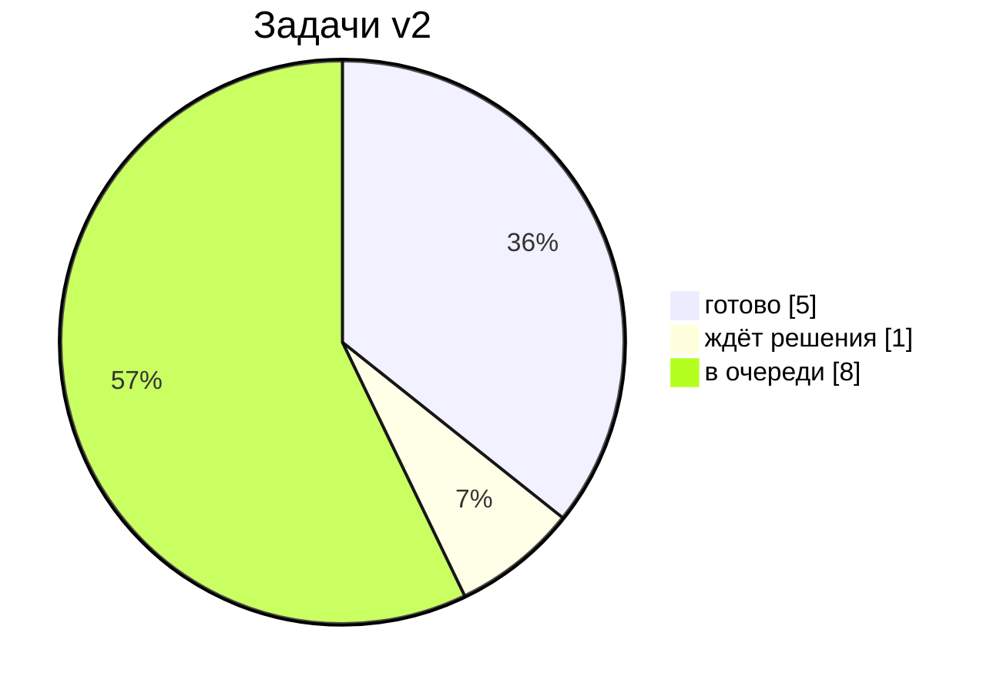

# IELTS Tutor — дашборд

Репозиторий [f513/IELTS-tutor](https://github.com/f513/IELTS-tutor) · ветка `claude/ielts-refactor`

## Где мы сейчас
> [!success] Фазы 0 и 1 — готовы
> Хранилище и трекинг настроены. Методика сведена в один источник: короткое ядро скилла + 4 справочника, агенты — тонкие обёртки.

> [!warning] Ждёт решения: [[P3-1 Эталон band 9]]
> Официального примера 9.0 в открытом доступе нет (максимум 7.5). Варианты — в [[project/Решения|журнале решений]].

> [!todo] Следующий шаг: Фаза 2 — [[P2-1 Профиль ученика и онбординг]]

## Задачи сейчас
![[project/Задачи.base#Сейчас]]

## Очередь
![[project/Задачи.base#Очередь]]

## Навигация
| Проект | Ученик | Методика |
|---|---|---|
| [[project/Roadmap\|Roadmap]] | [[learner/README\|Личный кабинет]] | [[data/analysis/reading\|Reading]] |
| [[project/Решения\|Журнал решений]] | [[learner/profile\|Профиль]] | [[data/analysis/listening\|Listening]] |
| [[project/Журнал\|Журнал работы]] | [[learner/progress\|Прогресс]] | [[data/analysis/speaking\|Speaking]] |
| [[project/Архитектура.canvas\|Карта архитектуры]] | [[learner/Сессии.base\|Занятия]] | [[data/analysis/writing\|Writing]] |
| [[calibration/README\|Калибровка]] | [[templates/Сессия\|Шаблон занятия]] | [[data/catalog\|Каталог 421 видео]] |

Для агентов: [[STATUS]] (технический чекпоинт) · [[PLAN]] (план v1) · `CLAUDE.md`.

> [!info] Где промпты тьютора
> Сам скилл лежит в `.claude/skills/ielts-tutor/`, агенты — в `.claude/agents/`.
> Obsidian не показывает папки с точкой, поэтому их не видно в дереве файлов —
> открывайте их в редакторе кода. Изменения в них отражаются здесь, в задачах и журнале.
