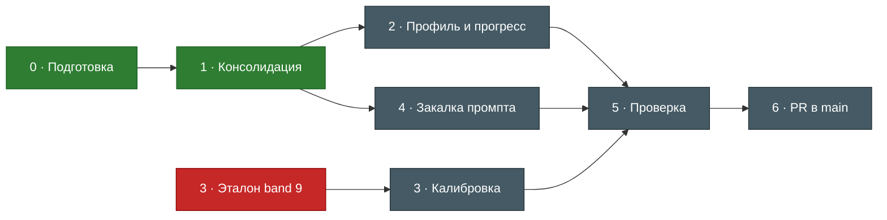

# Roadmap — IELTS Tutor v2

Ветка: `claude/ielts-refactor` → PR в `main`. Статусы задач живут в свойствах
заметок `project/tasks/*` — эта страница даёт общую картину.

Зелёный — готово · жёлтый — в работе · красный — ждёт решения · серый — в очереди.

## Фазы

### 0 · Подготовка ✅
- [[P0-1 Ветка и фикс путей]]
- [[P0-2 Obsidian-хранилище и трекинг]]

### 1 · Консолидация ✅
Одна методика вместо двух копий: короткое ядро + справочники по навыкам.
- [[P1-1 Короткое ядро скилла]]
- [[P1-2 Перенос методики в references без потерь]]
- [[P1-3 Агенты как опция]]

### 2 · Профиль и прогресс
- [[P2-1 Профиль ученика и онбординг]]
- [[P2-2 Таксономия ошибок по 4 навыкам]]
- [[P2-3 Журнал сессий и прогресса]]

### 3 · Калибровка
- [[P3-1 Эталон band 9]] ⛔ ждёт решения
- [[P3-2 Калибровочный набор]]
- [[P3-3 Прогон калибровки]]

### 4 · Закалка промпта
- [[P4-1 Закалка промпта]]

### 5 · Проверка
- [[P5-1 Проверка соблюдения правил]]

### 6 · Публикация
- [[P6-1 Pull request в main]]

## Плагин ECC по фазам
| Фаза | Инструмент ECC | Зачем |
|---|---|---|
| План | `ecc:plan` | план согласован до правок |
| 1 | `ecc:prompt-optimizer` | короткое ядро промпта |
| 3 | `ecc:eval-harness`, агент `ecc:agent-evaluator` | калибровка оценок |
| 5 | `ecc:skill-comply` | соблюдение правила честности |
| 6 | `ecc:pr` | pull request |

← [[00 Дашборд|Дашборд]]
